# Parte 1: despliegue y evidencia de infraestructura

**Responsable:** Nicolás (305108) · **Región:** us-east-1 (AWS Academy Learner Lab) · **Fecha:** 20/10/2026

## 1.1 Publicación en ECR y despliegue en ECS Fargate detrás de un ALB

### Arquitectura desplegada

```
Cliente (k6 / curl)
      │  HTTP :80
      ▼
Application Load Balancer  scoring-alb  (internet-facing)
      │  listener HTTP :80 → target group scoring-tg (HTTP :3000, target type ip)
      ▼
Servicio ECS  scoring-api  (cluster actividad2, Fargate, 1 tarea)
      │
      ▼
Contenedor api  ←  imagen ECR  scoring-app:latest
```

### Imagen publicada en ECR

La imagen se construyó para `linux/amd64` (la máquina de desarrollo es ARM) y se publicó en el repositorio `scoring-app`.

```bash
aws ecr get-login-password | docker login --username AWS --password-stdin <cuenta>.dkr.ecr.us-east-1.amazonaws.com
docker build --platform linux/amd64 -t <cuenta>.dkr.ecr.us-east-1.amazonaws.com/scoring-app:latest ./scoring-app
docker push <cuenta>.dkr.ecr.us-east-1.amazonaws.com/scoring-app:latest
```

| Repositorio | Tag | Digest | Publicada |
|---|---|---|---|
| scoring-app | latest | `sha256:e694a614…bce3a8f8d` | 20/10/2026 21:47 |

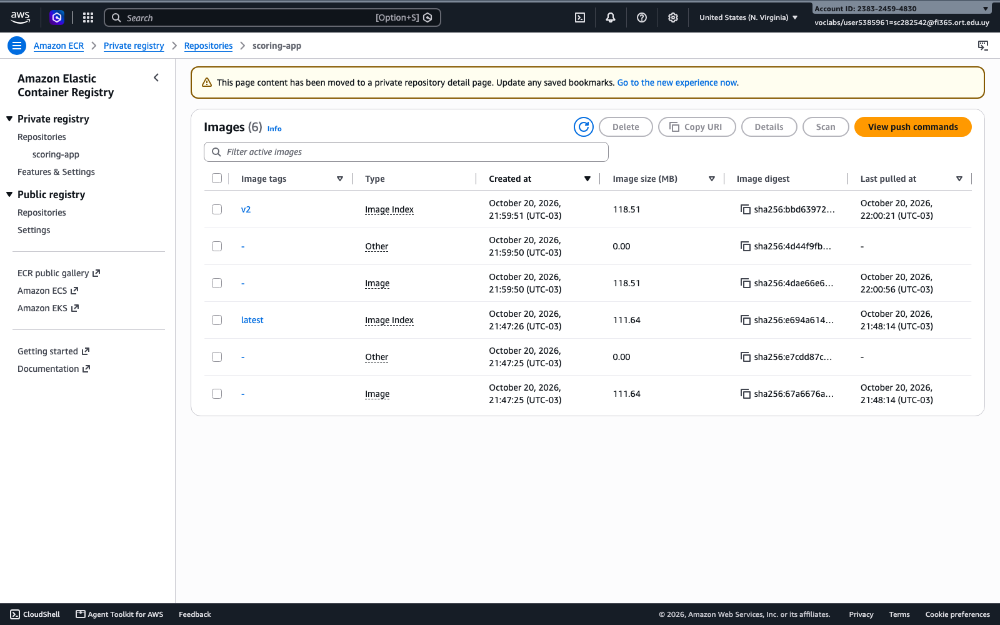

*Captura 1.1-a: ECR → Repositories → `scoring-app` → imagen `latest`.*
> *Demuestra que la imagen de la aplicación está publicada en ECR.*

### Servicio en ECS

| Campo | Valor |
|---|---|
| Cluster | `actividad2` |
| Servicio | `scoring-api` |
| Estado | ACTIVE |
| Launch type | FARGATE |
| Task definition | `scoring-app:1` |
| Tareas deseadas / corriendo | 1 / 1 |
| Load balancer | `scoring-alb` → target group `scoring-tg`, contenedor `api:3000` |

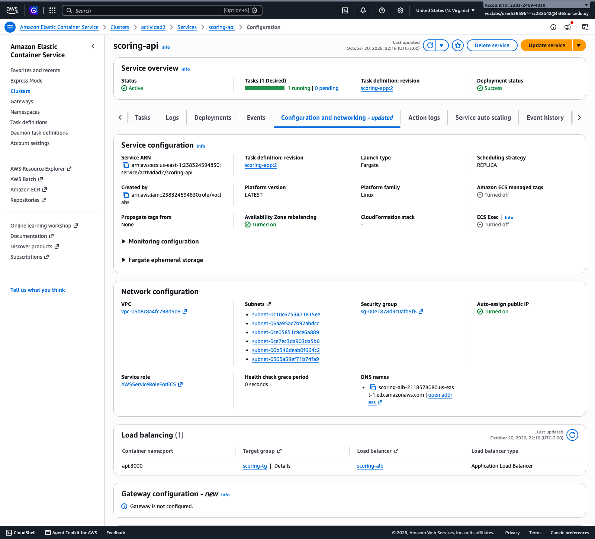

*Captura 1.1-b: ECS → Clusters → `actividad2` → Services → `scoring-api` → Configuration and networking. Servicio Fargate, estrategia REPLICA, red `awsvpc` con IP pública. (La captura se tomó después del despliegue de la Parte 2, por eso figura la revisión `scoring-app:2`; durante la Parte 1 el servicio corría `scoring-app:1`, ver 1.2-a y 1.4-b.)*
> *Demuestra que el servicio corre sobre Fargate y está asociado al ALB.*

### Target group

| Target group | Protocolo / puerto | Tipo de target | Estado del target |
|---|---|---|---|
| `scoring-tg` | HTTP / 3000 | ip | **healthy** |

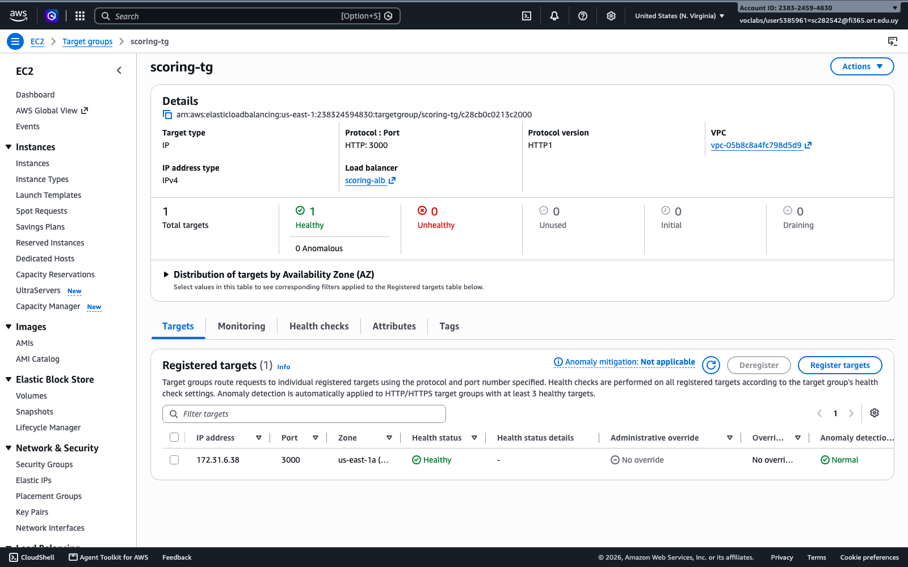

*Captura 1.1-c: EC2 → Target groups → `scoring-tg` → pestaña *Targets* con el target en `healthy`.*
> *Demuestra que el ALB enruta a la tarea y que esta pasa el health check.*

### Resultado de una solicitud

URL pública: `http://scoring-alb-2118578080.us-east-1.elb.amazonaws.com`

```
$ curl http://scoring-alb-2118578080.us-east-1.elb.amazonaws.com/health
{"status":"ok"}

$ curl -X POST http://scoring-alb-2118578080.us-east-1.elb.amazonaws.com/scoring \
    -H "Content-Type: application/json" \
    -d '{"CI":12345,"Nombre":"pepe","IngresoMensual":60000,"MontoSolicitado":300000,"PlazoMeses":24}'
{"id":"78c03485-fa45-4337-9982-7ab9b605270b","CI":12345,"Nombre":"pepe","score":958,"cuota":18682,"probabilidadImpago":0.0424,"aprobado":true}

HTTP 200 - tiempo total 6.16 s
```

> **[Captura 1.1-d]** Terminal o Postman con la solicitud anterior y su respuesta.
> *Demuestra que la aplicación responde a través del ALB.*

### Decisiones de configuración

| Decisión | Motivo |
|---|---|
| **0,25 vCPU / 512 MB, 1 tarea, sin auto scaling** | Es la configuración mínima de Fargate y representa el despliegue "tal cual" de la aplicación; sirve como línea base para medir. |
| **Imagen `linux/amd64` y tarea X86_64** | La máquina de build es ARM (Apple Silicon); la arquitectura de la imagen debe coincidir con la de la task definition o la tarea no arranca. |
| **Security group del ALB: puerto 80 abierto a internet** | Es el único punto de entrada público. |
| **Security group de las tareas: puerto 3000 solo desde el SG del ALB** | Mínimo privilegio: nadie puede llamar al contenedor salteando el load balancer. |
| **Target type `ip`** | Obligatorio con Fargate (modo de red `awsvpc`): cada tarea tiene su propia interfaz de red. |
| **Health check en `/health`** | Endpoint liviano que no toca el cálculo; si no responde, la tarea realmente no puede atender. |
| **`LabRole` como execution y task role** | En el Learner Lab no se pueden crear roles IAM; `LabRole` permite bajar la imagen de ECR y escribir logs. |
| **Telemetría desactivada (`OTEL_SDK_DISABLED=true`) y sin sidecar del collector** | No se cuenta con credenciales de Grafana Cloud y la letra no pide observabilidad; las métricas se toman de CloudWatch. |
| **Logs a CloudWatch (`awslogs`, grupo `/ecs/scoring-app`)** | Permite ver qué hace la aplicación bajo carga sin entrar al contenedor. |

## 1.2 Condiciones iniciales del despliegue

### Task definition `scoring-app:1`

| Parámetro | Valor |
|---|---|
| Compatibilidad | FARGATE |
| CPU | **256 (0,25 vCPU)** |
| Memoria | **512 MB** |
| Plataforma | Linux / X86_64 |
| Modo de red | awsvpc |
| Contenedor / puerto | `api` / 3000 |
| Execution role y task role | `LabRole` |
| Variables de entorno | `PORT=3000`, `OTEL_SDK_DISABLED=true` (sin collector de telemetría) |
| Tareas del servicio | 1 (sin auto scaling) |

### Health check del target group

| Parámetro | Valor |
|---|---|
| Path | `/health` |
| Intervalo | 30 s |
| Timeout | 5 s |
| Healthy threshold | 5 |
| Unhealthy threshold | 2 |
| Código esperado | 200 |

Con esta configuración, **si `/health` no responde en 5 s en dos chequeos seguidos (~60 s), el target se marca `unhealthy`** y ECS reemplaza la tarea.

### Solicitud exitosa sin carga

Una única solicitud, sin otras en curso, tarda **6,16 s** (ver 1.1). Es decir, **incluso sin concurrencia el tiempo de respuesta ya supera el umbral de 2500 ms** que pide la prueba, porque el cálculo ocupa toda la CPU de 0,25 vCPU de la tarea.

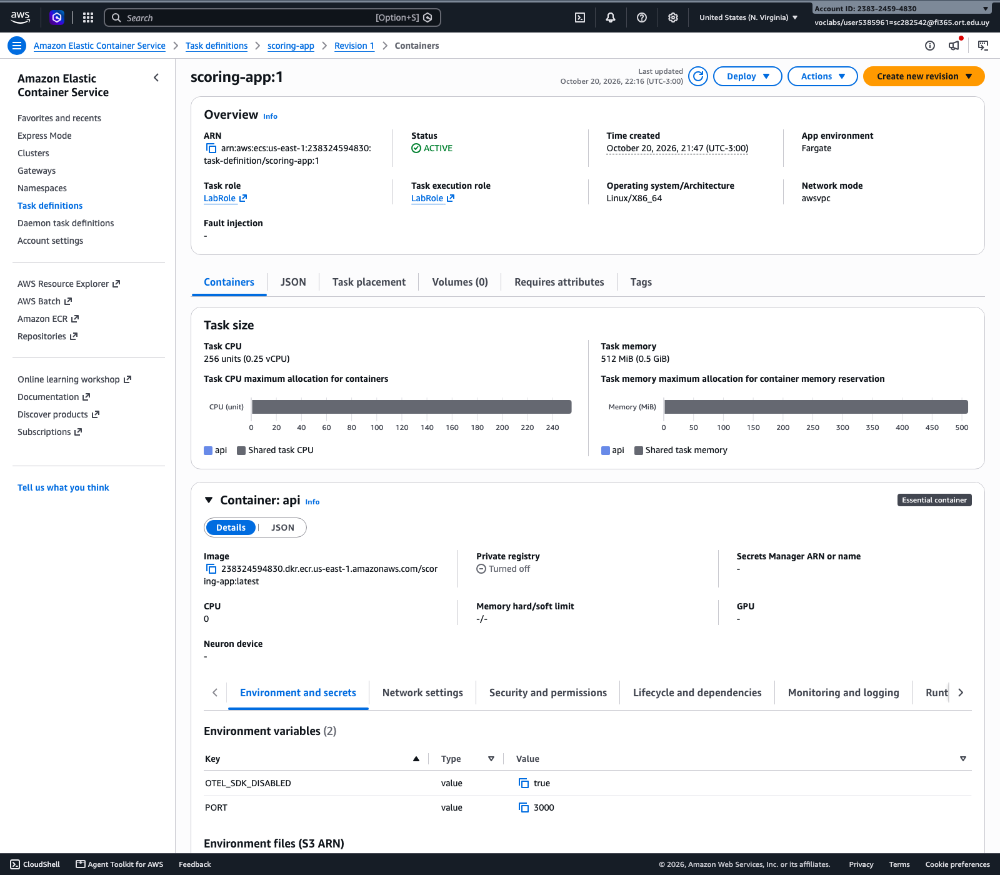

*Captura 1.2-a: ECS → Task definitions → `scoring-app` → revisión 1 (CPU, memoria, plataforma, puerto).*
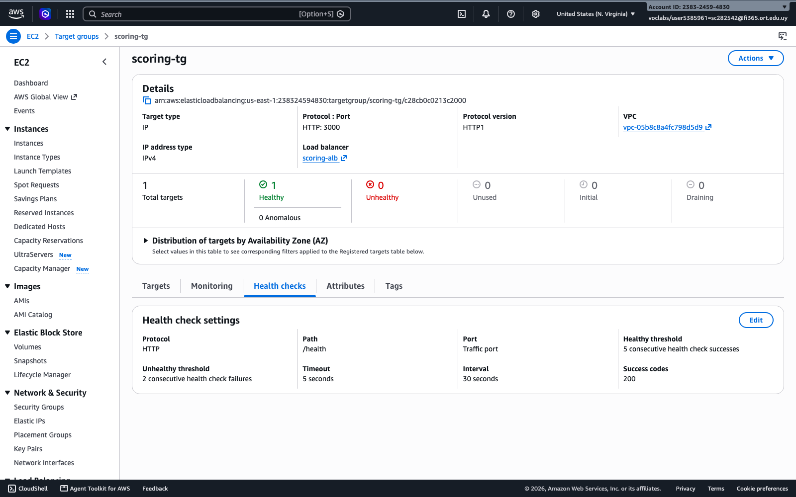

*Captura 1.2-b: EC2 → Target groups → `scoring-tg` → pestaña *Health checks*.*
> *Demuestran las condiciones iniciales sobre las que se ejecuta la prueba de carga.*

## 1.4 Evidencia de infraestructura durante la prueba de carga (insumo para el diagnóstico)

Datos tomados durante la ejecución de k6 (20/10/2026, 21:50–21:54).

### Eventos del servicio ECS

| Hora | Evento |
|---|---|
| 21:48:00 | `has started 1 tasks: (task f0e68e1b…)` (despliegue inicial) |
| 21:49:11 | `deployment completed` / `has reached a steady state` |
| 21:52:15 | `has started 1 tasks: (task 26d6becf…). Amazon ECS replaced 1 tasks due to an unhealthy status.` |
| 21:53:11 | `(task f0e68e1b…) (port 3000) is unhealthy in target-group scoring-tg due to (reason Request timed out).` |
| 21:53:11 | `has stopped 1 running tasks: (task f0e68e1b…)` |
| 21:53:21 | `has begun draining connections on 1 tasks` / `deregistered 1 targets in target-group scoring-tg` |

Motivo de detención de la tarea `f0e68e1b…`: **`Task failed ELB health checks in target-group scoring-tg`** (`stopCode: ServiceSchedulerInitiated`).

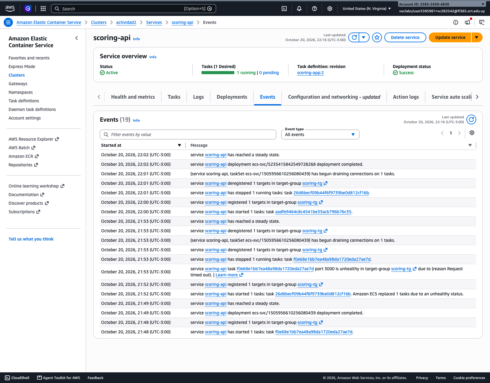

*Captura 1.4-a: ECS → `scoring-api` → pestaña *Events* con los mensajes anteriores.*
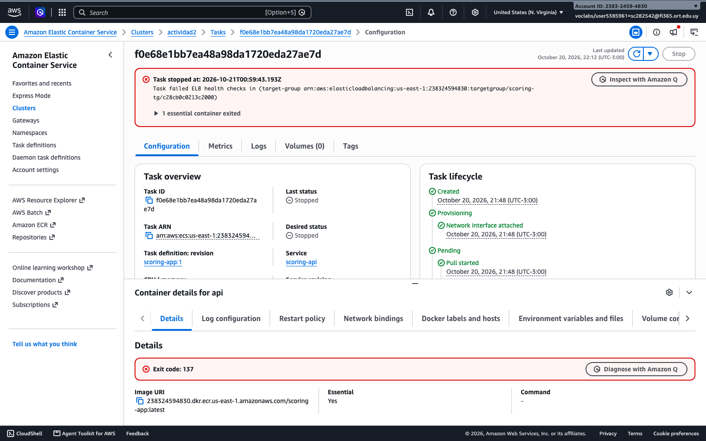

*Captura 1.4-b: ECS → `scoring-api` → *Tasks* → filtro *Stopped* → tarea `f0e68e1b…` con el *stopped reason*.*
> *Demuestran que el "reinicio" es ECS reemplazando la tarea porque falló el health check del ALB.*

### Estado del target group durante la prueba

| Minuto | Hosts unhealthy (máx.) |
|---|---|
| 21:50 | 0 |
| 21:51 | **1** |
| 21:52 | **1** |
| 21:53 | **1** |
| 21:54 | **1** |

Al final de la prueba el target viejo (`172.31.18.47`) quedó en `draining` (`Target.DeregistrationInProgress`) y el nuevo (`172.31.91.9`) en `healthy`.

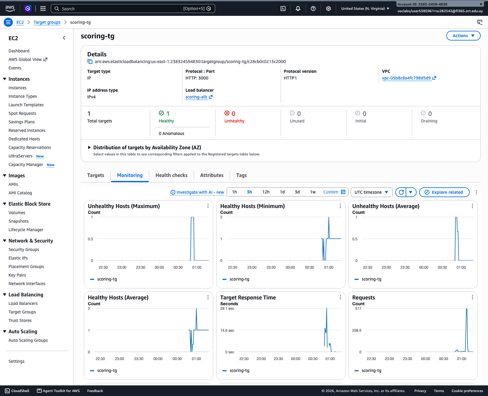

*Captura 1.4-c: EC2 → Target groups → `scoring-tg` → *Targets* (un target `draining`/`unhealthy`) y pestaña *Monitoring* → *Unhealthy hosts*.*
> *Demuestra que el ALB dejó de considerar sano al único target.*

### Uso de CPU y memoria de la tarea (CloudWatch, `AWS/ECS`)

| Minuto | CPU promedio | CPU máx. | Memoria máx. |
|---|---|---|---|
| 21:49 | 0,0 % | 0,1 % | 5,7 % |
| 21:50 | 0,8 % | 2,2 % | 6,3 % |
| 21:51 | **99,96 %** | **100 %** | 6,8 % |
| 21:52 | 49,96 % | **100 %** | 6,8 % |
| 21:53 | 87,63 % | **100 %** | 9,4 % |

La **CPU se satura al 100 %** apenas empieza la carga, mientras la **memoria no supera el 10 %**: el cuello de botella es CPU, no memoria. (El promedio de 21:52 baja porque en ese minuto se está reemplazando la tarea.)

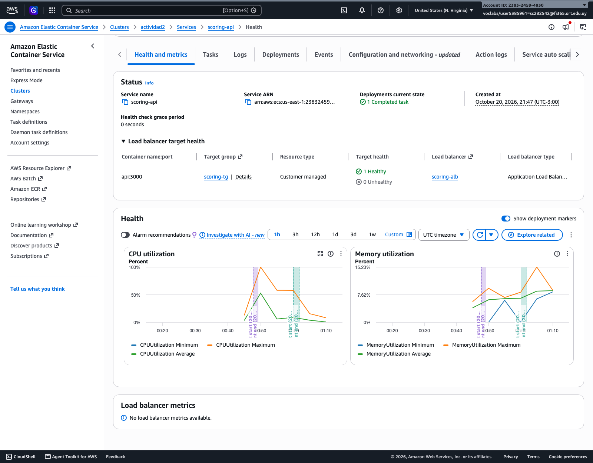

*Captura 1.4-d: ECS → `scoring-api` → *Health and metrics* (gráficas de CPU y memoria).*

### Códigos HTTP devueltos por el ALB (CloudWatch, `AWS/ApplicationELB`)

| Minuto | 2XX de la app | 502 | 504 | Total 5XX del ALB |
|---|---|---|---|---|
| 21:50 | 7 | 0 | 0 | 0 |
| 21:51 | 12 | **5** | 0 | 5 |
| 21:52 | 7 | **2** | **4** | 6 |
| 21:53 | 9 | **5** | **2** | 7 |

Mientras tanto, la aplicación solo completa **entre 7 y 12 solicitudes por minuto** (≈ 0,1–0,2 solicitudes/s): cada cálculo de scoring tarda varios segundos y se procesan de a uno.

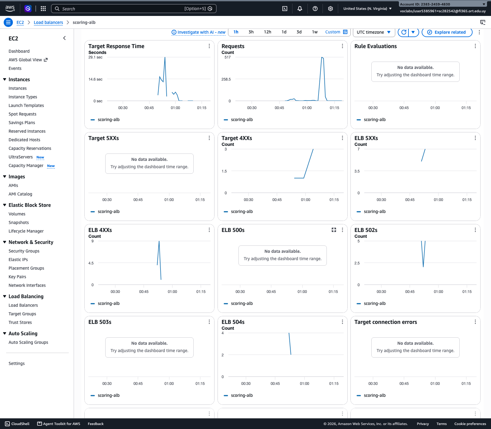

*Captura 1.4-e: EC2 → Load balancers → `scoring-alb` → *Monitoring* (ELB 5XX, Target response time, Requests).*
> *Demuestra los errores 502/504 generados por el ALB bajo carga.*

### Logs de la aplicación (CloudWatch Logs `/ecs/scoring-app`)

```
2026-10-21T00:53:21 {"CI":10050004,"Nombre":"pepe","level":"info","message":"Scoring calculado"}
2026-10-21T00:53:25 {"CI":10100004,"Nombre":"pepe","level":"info","message":"Scoring calculado"}
2026-10-21T00:53:26 {"CI":10090002,"Nombre":"pepe","level":"info","message":"Scoring calculado"}
2026-10-21T00:53:30 {"CI":10040002,"Nombre":"pepe","level":"info","message":"Scoring calculado"}
```

Los cálculos se completan **de a uno, cada 3–5 segundos**, aunque k6 envía solicitudes de 10 usuarios concurrentes.

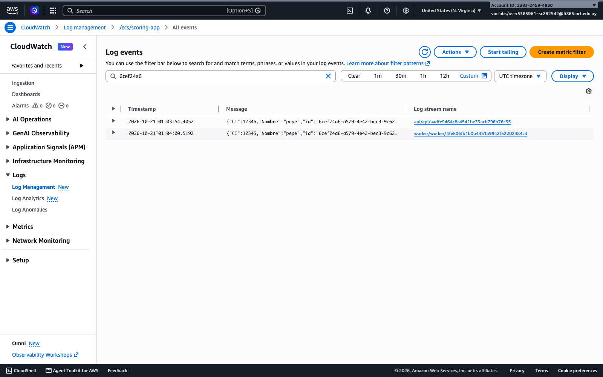

*Captura 1.4-f: CloudWatch → Log groups → `/ecs/scoring-app` (opcional).*

### Lectura de la evidencia (para la 1.4)

1. `calcularScore` es **síncrono y CPU-bound**: mientras calcula, el event loop de Node.js no atiende ninguna otra solicitud, **ni siquiera `/health`**.
2. Con 10 usuarios concurrentes, las solicitudes se encolan dentro de la tarea; el health check del ALB (timeout 5 s) no recibe respuesta, el target pasa a **unhealthy** y **ECS detiene la tarea y lanza otra**. Eso es el "el servicio se reinicia solo".
3. **502 Bad Gateway**: el ALB tenía conexiones abiertas con la tarea que ECS detuvo; la conexión se corta y el ALB devuelve 502.
4. **504 Gateway Timeout**: la tarea aceptó la conexión pero no respondió dentro del idle timeout del ALB (60 s), porque seguía bloqueada calculando las solicitudes anteriores.
5. **503 Service Unavailable**: aparece cuando no hay ningún target sano registrado (en esta corrida el reemplazo se registró antes de que se vaciara el target group, por eso no se observaron 503).
6. La memoria no supera el 10 %: **el recurso que se agota es la CPU**.

## Nota para el grupo: DNS del ALB

Un ALB recién creado tarda unos minutos en propagar su nombre DNS. Si se consulta antes, el sistema operativo puede cachear la respuesta negativa y `curl` falla con *"Could not resolve host"* aunque el ALB ya esté activo. Se resuelve esperando o limpiando la caché: `sudo dscacheutil -flushcache; sudo killall -HUP mDNSResponder`.

## Archivos de evidencia en texto (salidas de AWS CLI)

Carpeta `evidencia/parte1/`:

| Archivo | Contenido |
|---|---|
| `1.1-ecr-imagen.txt` | Imagen `scoring-app:latest` en ECR |
| `1.1-servicio-ecs.txt` | Descripción del servicio `scoring-api` |
| `1.1-alb.txt` | ALB `scoring-alb` (DNS, estado, esquema) |
| `1.1-solicitud-exitosa.txt` | `/health` y `POST /scoring` con tiempo de respuesta |
| `1.2-task-definition.txt` | CPU, memoria, plataforma y roles de la tarea |
| `1.2-target-group-health-check.txt` | Configuración del health check |
| `1.4-eventos-servicio.txt` | Eventos del servicio ECS |
| `1.4-tasks-detenidas.txt` | Tarea detenida y motivo |
| `1.4-target-health.txt` | Estado de los targets al final de la prueba |
| `1.4-CPUUtilization.txt` / `1.4-MemoryUtilization.txt` | Métricas de la tarea |
| `1.4-alb-codigos-http.txt` | Códigos 2XX/502/503/504 del ALB |
| `1.4-unhealthy-hosts.txt` | Hosts unhealthy por minuto |
