# Parte 2.2: despliegue de la nueva arquitectura

**Responsable:** Nicolás (305108) · **Región:** us-east-1 (AWS Academy Learner Lab) · **Fecha:** 20/10/2026

## Componentes desplegados

```
Cliente (k6 / curl)
      │  HTTP :80
      ▼
ALB scoring-alb ──► target group scoring-tg (/health)
      │
      ▼
Servicio ECS scoring-api (1 tarea, scoring-app:2)
      │  POST /scoring: valida, guarda PENDIENTE, encola, responde 202
      │  GET /scoring/:id: lee el estado
      ├──────────────► DynamoDB  Scorings (PK id)
      ▼                         ▲
SQS scoring-jobs ──(3 fallos)──► SQS scoring-jobs-dlq
      │                         │
      ▼                         │
Servicio ECS scoring-worker (2 tareas, scoring-worker:1)
      calcularScore() → guarda COMPLETADO / ERROR
```

| Componente | Nombre | Configuración |
|---|---|---|
| Imagen ECR | `scoring-app:v2` | Una sola imagen para API y worker (rama `feature/async-scoring`) |
| Servicio API | `scoring-api` | Fargate, 1 tarea, task definition `scoring-app:2`, detrás del ALB `scoring-alb` |
| Servicio worker | `scoring-worker` | Fargate, 2 tareas, task definition `scoring-worker:1`, comando `node worker.js`, **sin load balancer** |
| Cola | `scoring-jobs` | Standard, visibility timeout 60 s, DLQ `scoring-jobs-dlq` con **maximum receives = 3** |
| Cola de errores | `scoring-jobs-dlq` | Standard, recibe los mensajes que fallan 3 veces |
| Tabla | `Scorings` | DynamoDB, partition key `id` (String), on-demand (`PAY_PER_REQUEST`) |
| Recursos por tarea | API y worker | 0,25 vCPU / 512 MB, **igual que en la Parte 1** para comparar en las mismas condiciones |
| Roles | API y worker | `LabRole` (execution y task role: permisos para SQS y DynamoDB) |

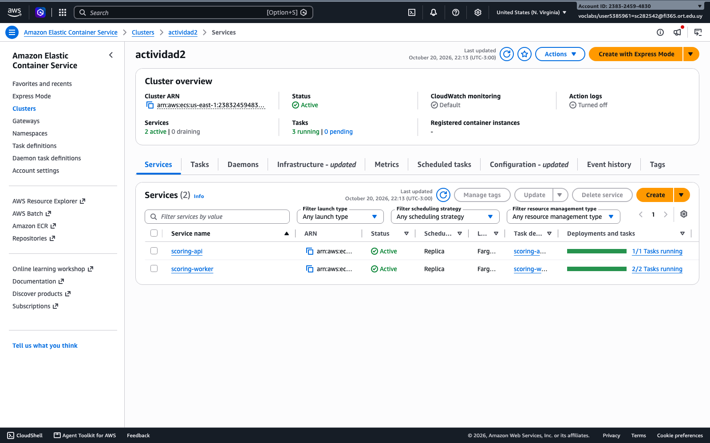

*Captura 2.2-a: ECS → Clusters → `actividad2` → *Services*: `scoring-api` y `scoring-worker` en estado Active con sus tareas corriendo.*
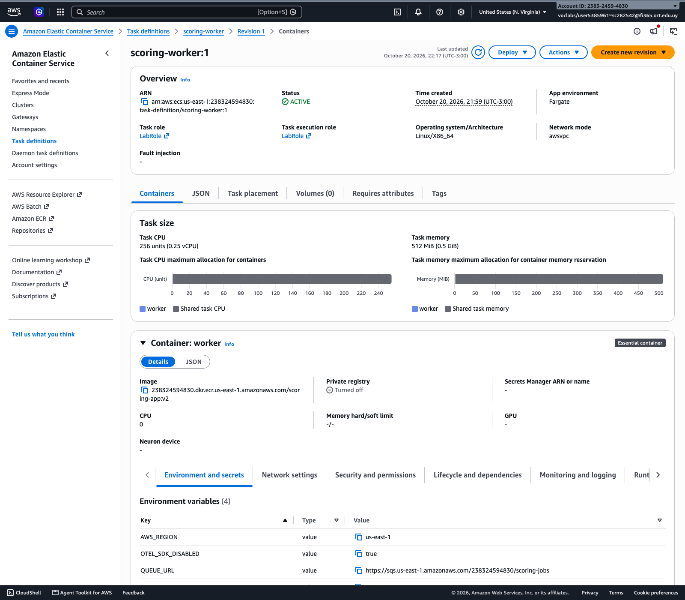

*Captura 2.2-b: ECS → Task definitions → `scoring-worker` → revisión 1 (comando `node worker.js`, variables de entorno).*
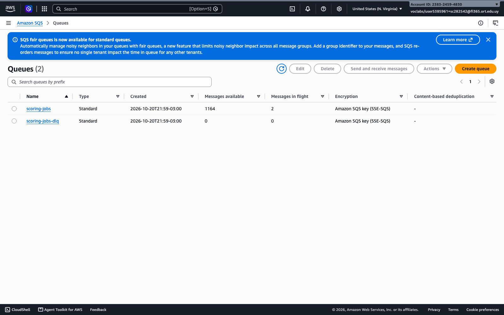

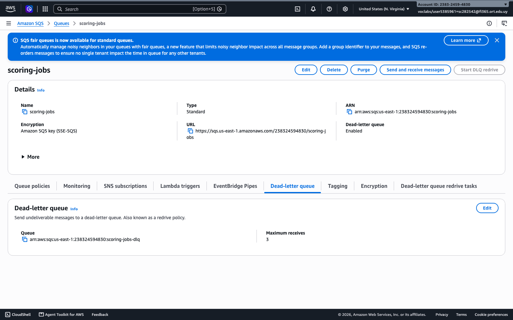

*Captura 2.2-c: SQS → Queues: `scoring-jobs` y `scoring-jobs-dlq`; y `scoring-jobs` → pestaña *Dead-letter queue* (DLQ asociada, maximum receives 3).*
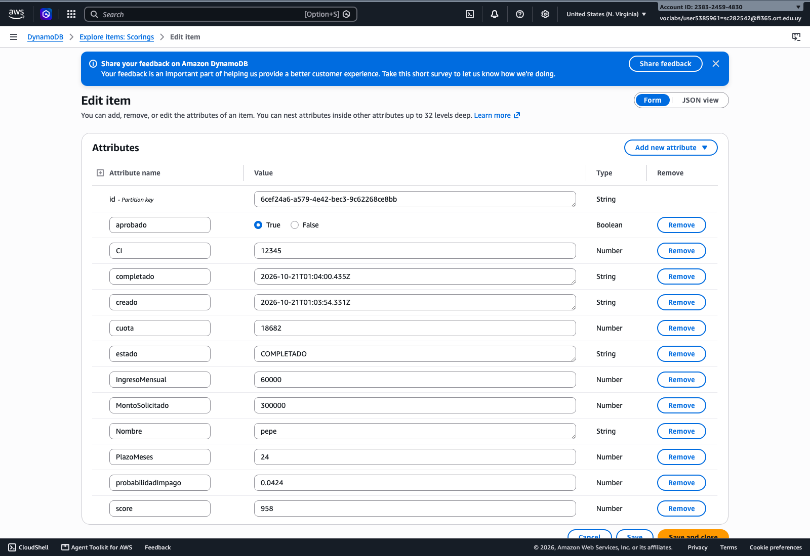

*Captura 2.2-d: DynamoDB → Tables → `Scorings` → *Explore table items* con la solicitud en estado `COMPLETADO`.*
> *Demuestran los componentes de la nueva arquitectura.*

## Decisiones de infraestructura

| Decisión | Motivo |
|---|---|
| **El worker es un servicio ECS aparte, sin load balancer** | El cálculo pesado ya no corre en el proceso que atiende HTTP: aunque el worker esté al 100 % de CPU, la API y su health check siguen respondiendo. El worker no recibe tráfico, así que no necesita ALB ni health check HTTP. |
| **Una sola imagen, dos comandos** (`node index.js` / `node worker.js`) | Un solo build y un solo push; API y worker siempre comparten la misma versión de `scoring.js` (mismo modelo). |
| **SQS Standard entre API y worker** | Desacopla la recepción del procesamiento: los picos quedan en la cola en vez de saturar la API. Entrega *at least once*, por eso el worker es idempotente (si el item ya está `COMPLETADO`, descarta el duplicado). |
| **Visibility timeout de 60 s** | Un cálculo tarda ~6 s en 0,25 vCPU; 60 s da margen para que otro worker no tome el mismo mensaje mientras se procesa. Si el worker muere, el mensaje reaparece al vencer ese tiempo. |
| **DLQ con maximum receives = 3** | Un mensaje que falla 3 veces (por ejemplo, un error inesperado) pasa a `scoring-jobs-dlq` para revisarlo, en vez de reintentarse para siempre y bloquear a los workers. |
| **El worker borra el mensaje al final** | Si la tarea se detiene a mitad del cálculo, el mensaje no se pierde: vuelve a la cola. |
| **DynamoDB on-demand (`PAY_PER_REQUEST`)** | La carga es variable (picos en horario de atención); no hace falta estimar capacidad. Acceso por clave (`id`), que es justo el patrón de `GET /scoring/:id`. |
| **Misma CPU y memoria que en la Parte 1 (0,25 vCPU / 512 MB)** | Para que la comparación de k6 sea en igualdad de condiciones: la mejora viene de la arquitectura, no de más recursos por tarea. |
| **`LabRole` como task role** | Da a la API y al worker permisos sobre SQS y DynamoDB sin credenciales en el código ni en variables de entorno. |

## Capacidad y escalado del worker

- Un worker de 0,25 vCPU calcula **1 scoring cada ~6 s ≈ 10 por minuto**. Con 2 workers: **≈ 20 por minuto**.
- La API ya no es el límite: solo valida, escribe en DynamoDB y encola (≈ 0,5 s por solicitud, sin bloquear el event loop).
- Si entran más solicitudes por minuto de las que procesan los workers, **la cola crece pero no se pierde nada ni falla la API**: las solicitudes quedan `PENDIENTE` hasta que un worker las toma.
- Escalado propuesto: **ECS Service Auto Scaling sobre `scoring-worker` con la métrica de profundidad de la cola** (`ApproximateNumberOfMessagesVisible` de SQS, o mensajes por tarea). Ejemplo: mínimo 2 tareas, máximo 10, objetivo ≈ 10 mensajes pendientes por tarea. La API escala por separado según CPU o cantidad de requests del ALB.
- Esto permite dimensionar cada parte por su propia carga: muchas tareas chicas de API para recibir, y tantos workers como pida la cola en el horario pico.

## Solicitud procesada de punta a punta

```
$ curl -X POST http://scoring-alb-2118578080.us-east-1.elb.amazonaws.com/scoring \
    -H 'Content-Type: application/json' \
    -d '{"CI":12345,"Nombre":"pepe","IngresoMensual":60000,"MontoSolicitado":300000,"PlazoMeses":24}'
{"id":"6cef24a6-a579-4e42-bec3-9c62268ce8bb","estado":"PENDIENTE"}
HTTP 202 - tiempo total 0.578s

$ curl http://scoring-alb-2118578080.us-east-1.elb.amazonaws.com/scoring/6cef24a6-a579-4e42-bec3-9c62268ce8bb   # inmediatamente
{"id":"6cef24a6-a579-4e42-bec3-9c62268ce8bb","estado":"PENDIENTE","CI":12345,"Nombre":"pepe"}
HTTP 200

$ curl http://scoring-alb-2118578080.us-east-1.elb.amazonaws.com/scoring/6cef24a6-a579-4e42-bec3-9c62268ce8bb   # unos segundos después
{"id":"6cef24a6-a579-4e42-bec3-9c62268ce8bb","estado":"COMPLETADO","CI":12345,"Nombre":"pepe","score":958,"cuota":18682,"probabilidadImpago":0.0424,"aprobado":true}
HTTP 200
```

Logs (CloudWatch `/ecs/scoring-app`): la API encola y el worker calcula 6 s después.

```
01:03:54 {"CI":12345,"Nombre":"pepe","id":"6cef24a6-…","level":"info","message":"Scoring encolado"}      ← API
01:04:00 {"CI":12345,"Nombre":"pepe","id":"6cef24a6-…","level":"info","message":"Scoring calculado","score":958}   ← worker
```

Observaciones:

- El `POST /scoring` responde **202 en 0,58 s**, frente a **200 en 6,16 s** de la Parte 1 para la misma solicitud.
- El resultado es **idéntico al de la Parte 1** (score 958, cuota 18682, probabilidad de impago 0,0424): el modelo y la cantidad de simulaciones no cambiaron, solo dónde se ejecuta el cálculo.
- Validaciones en el borde: datos inválidos → `400 {"error":"Datos de solicitud inválidos"}` sin encolar; id inexistente → `404 {"error":"Solicitud no encontrada"}`.

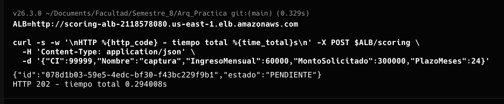

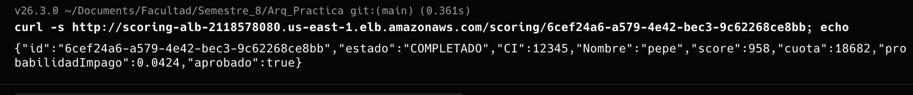

*Captura 2.2-e: el `POST /scoring` responde **202 en 0,29 s** con el `id` y estado `PENDIENTE`; el `GET /scoring/:id` de una solicitud ya procesada devuelve `COMPLETADO` con el mismo resultado que la versión original (score 958, cuota 18682, aprobado).*


*Captura 2.2-f: CloudWatch → Log groups → `/ecs/scoring-app`: líneas "Scoring encolado" (stream `api/…`) y "Scoring calculado" (stream `worker/…`).*
> *Demuestran una solicitud procesada de punta a punta por la nueva arquitectura.*

## Durante la prueba k6 de la Parte 2 (evidencia de que no hay reinicios)

Corrida de k6 de la Parte 2: **20/10/2026, 22:07–22:10**, mismo script y misma carga que en la Parte 1, contra `POST /scoring`. Datos de CloudWatch (archivos `2.3-*.txt`).

### Lo que vio el ALB

| Minuto | Requests | 2XX de la app | 5XX del ALB (502/503/504) | Tiempo de respuesta del target, p95 |
|---|---|---|---|---|
| 22:07 | 246 | 246 | 0 | 0,024 s |
| 22:08 | 517 | 517 | 0 | 0,016 s |
| 22:09 | 501 | 501 | 0 | 0,022 s |
| 22:10 | 47 | 47 | 0 | 0,019 s |
| **Total** | **1311** | **1311 (100 %)** | **0** | **≈ 0,02 s** |

En la Parte 1, con la misma carga, el ALB registró 7–25 requests por minuto, 502 y 504, y un tiempo de respuesta p95 del target de **31–37 s**.

### Estado de los servicios

- **Eventos de `scoring-api`**: el último evento es el despliegue de la v2 (22:02, *steady state*). **No hay ningún "unhealthy", "failed ELB health checks" ni "replaced tasks" durante ni después de la prueba.**
- **Target group**: *Unhealthy hosts* = 0 en toda la ventana de la Parte 2 (el único pico de la gráfica es el de la Parte 1, 21:52).

| Minuto | CPU API (máx.) | CPU worker (máx.) |
|---|---|---|
| 22:07 | 15,2 % | 100 % |
| 22:08 | 14,1 % | 100 % |
| 22:09 | 15,5 % | 100 % |
| 22:10 | 8,1 % | 100 % |

**La CPU de la API no supera el 16 %** porque ya no calcula: solo valida, escribe en DynamoDB y encola. El trabajo pesado está aislado en los workers, que trabajan al 100 % sin afectar a la API ni a su health check.

### Cola y procesamiento

- Al terminar la prueba: **1314 solicitudes registradas** en `Scorings`, **269 `COMPLETADO`**, **1046 `PENDIENTE`** (en cola), **0 `ERROR`**, **0 mensajes en la DLQ**.
- La API aceptó las 1311 solicitudes en ~3,5 minutos; los 2 workers procesan ~20 por minuto. Ninguna solicitud se perdió ni falló: las pendientes quedan en la cola y se completan a medida que los workers las toman.
- Esto confirma el punto de "Capacidad y escalado del worker": para que el tiempo hasta tener el resultado también sea corto en el pico, hay que escalar la cantidad de workers según la profundidad de la cola.

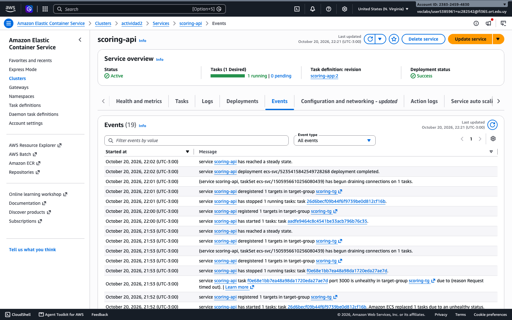

*Captura 2.2-g: ECS → `scoring-api` → *Events*: sin mensajes de "unhealthy" ni "replaced tasks".*


*Captura 2.2-h: EC2 → Target groups → `scoring-tg` → *Targets*: target `healthy` durante toda la prueba.*
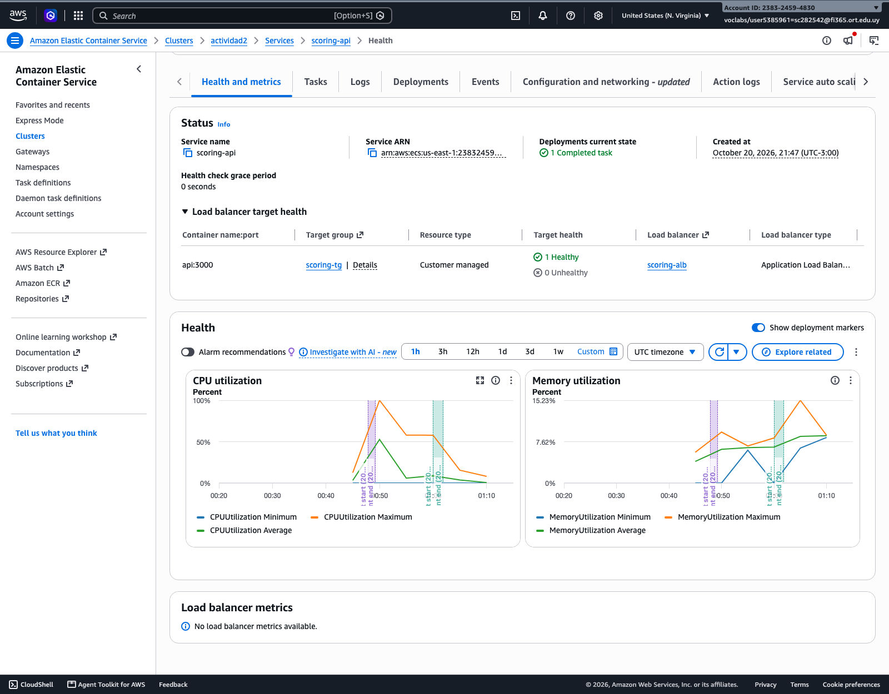

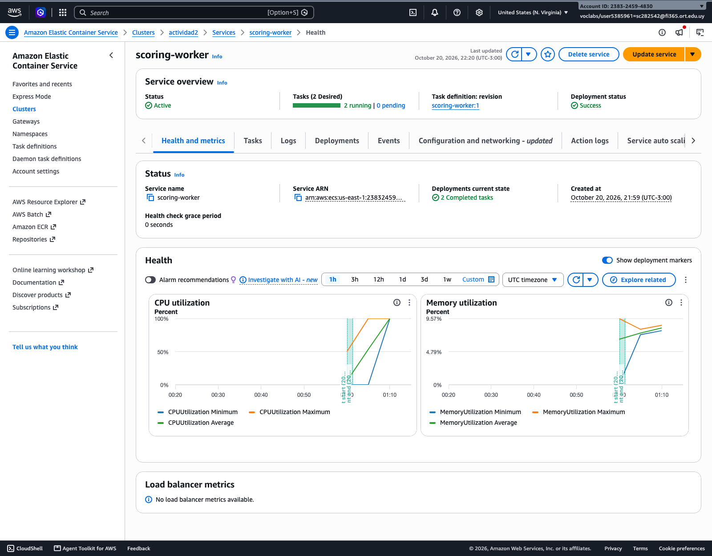

*Captura 2.2-i: ECS → `scoring-api` → *Health and metrics*: CPU de la API baja (ya no calcula).*
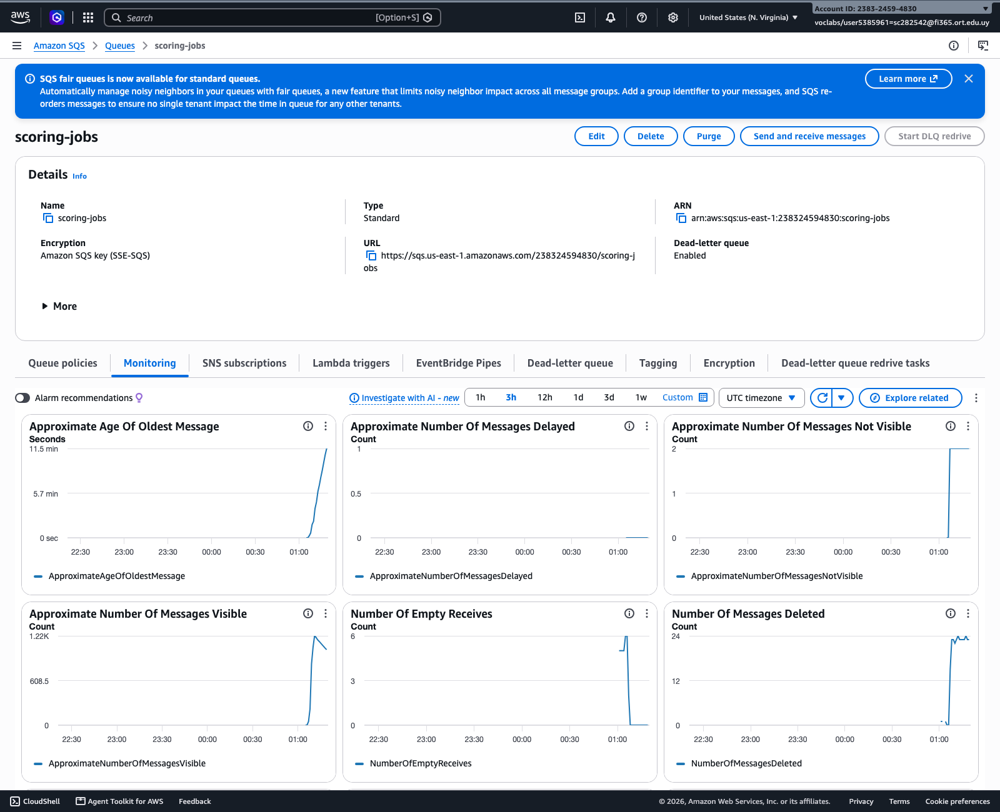

*Captura 2.2-j: SQS → `scoring-jobs` → *Monitoring*: mensajes encolados y consumidos por los workers.*

## Archivos de evidencia en texto

Carpeta `evidencia/parte2/`:

| Archivo | Contenido |
|---|---|
| `2.2-servicios-ecs.txt` | Servicios `scoring-api` y `scoring-worker` |
| `2.2-task-definitions.txt` | Task definitions de API (rev. 2) y worker |
| `2.2-colas-sqs.txt` | Atributos de `scoring-jobs` (DLQ, visibility timeout) y `scoring-jobs-dlq` |
| `2.2-tabla-dynamodb.txt` | Tabla `Scorings` y el item procesado |
| `2.2-punta-a-punta.txt` | POST 202 → GET PENDIENTE → GET COMPLETADO, 400 y 404 |
| `2.2-logs-api-worker.txt` | Logs de la API encolando y del worker calculando |
| `2.2-eventos-servicios.txt` | Eventos de ambos servicios tras el despliegue |
| `2.3-alb-durante-k6.txt` | Requests, códigos HTTP, tiempo de respuesta y hosts unhealthy durante k6 de la Parte 2 |
| `2.3-cpu-memoria-durante-k6.txt` | CPU y memoria de API y worker durante la prueba |
| `2.3-sqs-durante-k6.txt` | Mensajes enviados, borrados y visibles en la cola y la DLQ |
| `2.3-eventos-sin-reinicios.txt` | Eventos de ambos servicios después de la prueba |
| `2.3-estados-dynamodb.txt` | Cantidad de solicitudes por estado al terminar la prueba |
