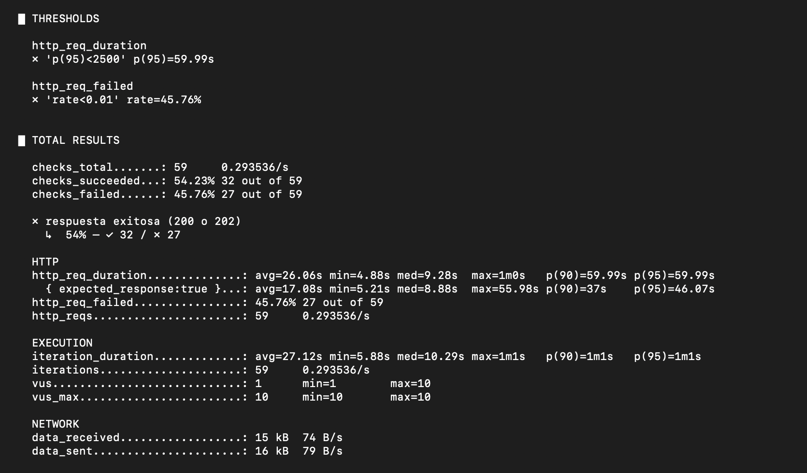
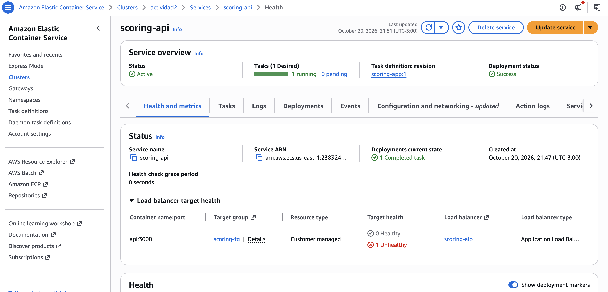
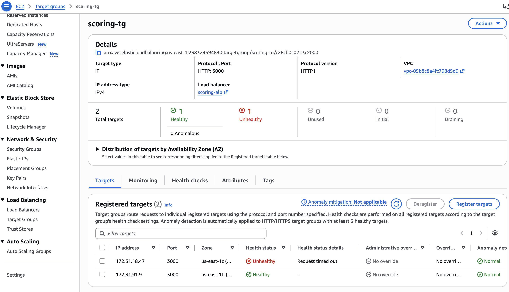
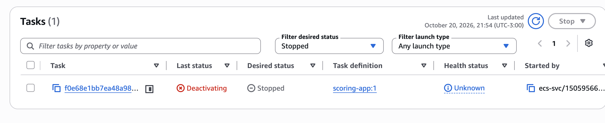

# Secciones 1.3, 1.4 y 2.3 (Santiago, 282542)

Texto para pegar en el documento compartido. La Parte 1 ya tiene los resultados reales de la corrida del 20/10 a las 21:50. Los valores entre corchetes de la sección 2.3, como `[P95_P2]`, se completan cuando corramos la prueba sobre la versión nueva.

## 1.3 Prueba de rendimiento con k6

Elegimos una prueba de carga (load test) con rampa, porque lo que la financiera nos describe es un escenario de uso normal pero sostenido: el scoring pasa a formar parte del alta de préstamos de la web y de todas las sucursales, así que durante el horario de atención va a recibir muchas solicitudes simultáneas durante un buen rato, no un golpe aislado. La prueba de carga reproduce justamente eso. Sube de forma gradual hasta el nivel de concurrencia esperado, lo mantiene y después baja, y nos permite validar si el servicio cumple los umbrales de la letra en condiciones realistas.

Descartamos las otras opciones por motivos concretos. Una prueba de estrés busca a propósito el punto en que el sistema se rompe, y eso no es lo que nos pide la financiera, que quiere saber si aguanta el uso esperado. Una prueba de pico (spike) mide la reacción ante un salto instantáneo de tráfico, pero el problema reportado aparece con carga sostenida, no con una ráfaga puntual. Una prueba de humo (smoke) con uno o dos usuarios no alcanza para ver ningún efecto de concurrencia.

Fijamos la carga en 10 usuarios virtuales concurrentes: 30 segundos de rampa, 2 minutos sostenidos y 30 segundos de bajada, con una pausa de 1 segundo entre solicitudes de cada usuario. Cada iteración usa una CI distinta, porque el modelo genera los números aleatorios a partir de la CI y no queríamos que la prueba repitiera siempre al mismo solicitante. Los umbrales están escritos en el propio script, así que k6 marca la prueba como fallida si el P(95) de `http_req_duration` supera los 2500 ms o si `http_req_failed` llega al 1 %. Estas condiciones quedan congeladas para repetirlas idénticas en la Parte 2.

Script (`k6/scoring-load.js`):

```javascript
[pegar aquí el contenido de k6/scoring-load.js]
```

Comando: `k6 run -e BASE_URL=http://scoring-alb-2118578080.us-east-1.elb.amazonaws.com k6/scoring-load.js`



Esta captura muestra el resumen de k6 de la Parte 1: los dos thresholds fallan, con un P(95) de 59,99 s y un 45,76 % de solicitudes fallidas.

Resultados de la Parte 1:

| Métrica | Valor |
|---|---|
| P(95) de `http_req_duration` | 59,99 s |
| Mediana de `http_req_duration` | 9,28 s |
| Tiempo mínimo de respuesta | 4,88 s |
| `http_req_failed` | 45,76 % (27 de 59) |
| Total de solicitudes (`http_reqs`) | 59 |
| Solicitudes por segundo | 0,29 |
| ¿Cumple los umbrales? | No, falla los dos |

El servicio no cumplió ninguno de los dos umbrales, y por mucho. El P(95) quedó en 59,99 segundos, 24 veces por encima del límite de 2,5 segundos, y casi la mitad de las solicitudes falló. En 3 minutos con 10 usuarios el servicio procesó apenas 59 solicitudes. Antes de la prueba hicimos una sola solicitud, sin carga, y ya tardó 4,59 segundos, así que el servicio no cumple el umbral ni siquiera con un único usuario.

## 1.4 Diagnóstico: por qué el servicio se reinicia y de dónde salen los 502/503

Los resultados de k6 muestran que el servicio no se degrada de a poco, sino que colapsa. Para entender por qué, fuimos primero al código y después a la evidencia de ECS, del target group y del load balancer.

El origen está en `calcularScore`, dentro de `scoring-app/scoring.js`. Para cada solicitud, el modelo corre 1.500.000 simulaciones de 12 meses cada una, lo que suma unos 18 millones de iteraciones con logaritmos, raíces y cosenos. Antes del despliegue medimos el cálculo en una de nuestras computadoras, con un núcleo completo, y tardó entre 0,8 y 0,9 segundos por solicitud. La tarea de ECS tiene asignados 0,25 vCPU y 512 MB de memoria, y en AWS una sola solicitud sin carga tardó 4,59 segundos. No podemos reducir la cantidad de simulaciones porque el área de riesgo no lo permite, así que ese costo es fijo.

El problema de fondo no es solo que el cálculo sea pesado, sino dónde corre. El handler de `POST /scoring` ejecuta el cálculo de forma síncrona en el hilo principal de Node.js, que tiene un único event loop. Mientras calcula un score, el proceso no puede atender ninguna otra solicitud. Con 10 usuarios concurrentes, las solicitudes forman una fila y cada una espera a que terminen todas las anteriores. Por eso la mediana fue de 9,28 segundos, el doble del tiempo de una solicitud aislada, y el P(95) llegó a los 60 segundos, que es el límite que k6 espera antes de abandonar la solicitud.

Lo que convierte la lentitud en reinicios es el health check. El endpoint `/health` corre en ese mismo event loop, así que mientras hay cálculos en la fila tampoco responde. El target group `scoring-tg` revisa `/health` cada 30 segundos con un timeout de 5 segundos, y marca el target como `unhealthy` después de 2 fallos seguidos. Durante la prueba muestreamos el estado del target cada 5 segundos: lo encontramos 20 veces `healthy`, 21 veces `unhealthy` con el motivo `Target.Timeout` y 9 veces `draining`. Cuando el target queda `unhealthy`, ECS asume que la tarea está rota, la detiene y lanza otra. Los eventos del servicio lo muestran con claridad:

| Hora | Evento de ECS |
|---|---|
| 21:52:15 | `has started 1 tasks ... Amazon ECS replaced 1 tasks due to an unhealthy status.` |
| 21:53:11 | `(task f0e68e1b...) (port 3000) is unhealthy in target-group scoring-tg due to (reason Request timed out).` |
| 21:53:11 | `has stopped 1 running tasks: (task f0e68e1b...).` |
| 21:53:21 | `has begun draining connections on 1 tasks.` |

El motivo de parada de la tarea detenida es `Task failed ELB health checks in (target-group scoring-tg)`, con el código `ServiceSchedulerInitiated`. Eso es exactamente el "se reinicia solo" que reporta la financiera: la aplicación no se cae por un error propio, sino que ECS la mata porque no contesta el health check a tiempo. Encima, la tarea nueva arranca en las mismas condiciones, recibe la misma fila de solicitudes y termina igual, así que el ciclo se repite mientras dure la carga.



Esta captura muestra el servicio `scoring-api` durante la prueba, con su único target marcado como `Unhealthy` en el load balancer.



Esta captura muestra el target group `scoring-tg` en el momento del reemplazo: la tarea original (172.31.18.47) está `Unhealthy` con el detalle `Request timed out`, y la tarea de reemplazo (172.31.91.9) ya figura como `Healthy`.



Esta captura muestra la tarea `f0e68e1b...` detenida por el servicio, con estado `Deactivating`.

[Captura: pestaña Events del servicio scoring-api con los eventos de la tabla]

Los errores salen de ese ciclo, y los contamos combinando k6 con las métricas del ALB en CloudWatch. De las 27 solicitudes fallidas, 15 fueron timeouts del lado de k6, que esperaron 60 segundos en la fila sin recibir respuesta. Otras 7 fueron 502 Bad Gateway, que el ALB devuelve cuando el target corta la conexión o responde de forma inválida, y eso pasa cuando ECS detiene una tarea que todavía tenía solicitudes en curso. Las 4 restantes fueron 504 Gateway Timeout, que el ALB devuelve cuando el target no contesta dentro de su propio límite de espera. En esta corrida no registramos ningún 503, y preferimos decirlo en lugar de forzar la explicación. El 503 lo devuelve el ALB cuando el target group se queda sin ningún target sano. En nuestra prueba eso no llegó a pasar, porque la tarea de reemplazo se registró como sana antes de que la original terminara de salir. Con más carga, o con varios reemplazos seguidos, el servicio puede quedarse sin targets sanos, y ahí aparecen los 503 que reporta la financiera.

Para descartar otras causas miramos los recursos de la tarea en CloudWatch. La CPU pasó de menos del 3 % antes de la prueba al 100 % durante los tres minutos en que corrió, mientras que la memoria nunca superó el 9,4 %. No es un problema de memoria ni de dependencias externas, porque la aplicación no llama a ninguna base de datos ni servicio. Es un problema de CPU en el hilo principal.

[Captura: Health and metrics del servicio con la CPU al 100 % y la memoria baja]

En resumen, el cuello de botella es el cálculo de Monte Carlo ejecutado de forma síncrona dentro de la solicitud HTTP. Bloquea el event loop, encola las solicitudes, hace fallar el health check y desencadena los reinicios que producen los 502, los 504 y, con suficiente carga, los 503.

## 2.3 Comparación de resultados

Volvimos a correr el mismo script, sin tocar una línea, contra el `POST /scoring` de la versión con cola y workers, con la misma CPU y memoria por tarea que en la Parte 1 para que la comparación fuera justa.

[Captura: resumen de k6 de la Parte 2]

| Métrica | Parte 1 (síncrono) | Parte 2 (cola y workers) |
|---|---|---|
| P(95) de `http_req_duration` | 59,99 s | [P95_P2] |
| `http_req_failed` | 45,76 % | [FAILED_P2] |
| Total de solicitudes (`http_reqs`) | 59 | [REQS_P2] |
| Solicitudes por segundo | 0,29 | [RPS_P2] |
| ¿Cumple los umbrales? | No | [SI_NO_P2] |
| Reinicios de tareas durante la prueba | 1 | [REINICIOS_P2] |

[Captura: eventos del servicio ECS durante la prueba de la Parte 2, sin reinicios]

El P(95) bajó de 59,99 segundos a [P95_P2] y la tasa de errores pasó de 45,76 % a [FAILED_P2], así que ahora sí cumplimos los dos umbrales. Además procesamos [REQS_P2] solicitudes contra 59 en el mismo tiempo, porque los usuarios virtuales ya no pasan la mayor parte de la prueba esperando en la fila. La mejora no viene de que el cálculo sea más rápido, porque es exactamente el mismo, sino de que la API ya no lo ejecuta: valida los datos, guarda la solicitud como `PENDIENTE`, la manda a la cola y responde 202 en milisegundos. El event loop queda libre, `/health` contesta siempre y ECS no vuelve a reiniciar la tarea durante la prueba.

Hay un matiz que queremos dejar explícito para no sobrevender el resultado. El P(95) de la Parte 2 mide cuánto tarda el sistema en aceptar la solicitud, no cuánto tarda en tener el score listo. El cálculo sigue llevando el mismo tiempo, ahora en los workers, y el resultado aparece unos segundos después al consultar `GET /scoring/:id`. Al terminar la prueba quedaron [MENSAJES_EN_COLA] mensajes pendientes en `scoring-jobs`, que los workers procesaron en [TIEMPO_VACIAR_COLA]. Si la carga real fuera mayor que lo que los workers pueden procesar, la cola crecería y la espera del solicitante también, aunque la API no fallaría. Ese es el punto donde, como siguiente paso, escalaríamos los workers según la cantidad de mensajes en la cola.
